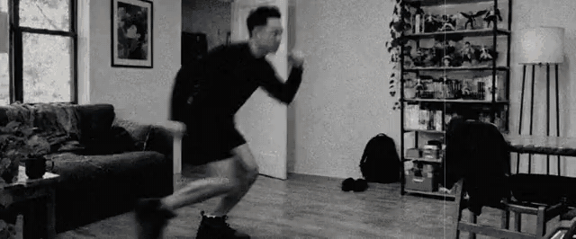

# Glitch Edit

Turns any clip into a glitch edit. No coding: your agent does it.

## Install

Paste this into Claude Code, Codex or any agent:

"Install this skill for me: https://github.com/open-longlabs/glitch-edit-skill"

Claude app: download [glitch-edit.zip](https://github.com/open-longlabs/glitch-edit-skill/releases/latest/download/glitch-edit.zip), then Settings > Capabilities > upload it as a skill.

## Use it

"Apply the glitch edit to my_clip.mp4"

## Want my scripts too?

Grab the `extras` folder as well. It has my playbooks and scripts from the Nike spec ad. Tell your agent "also use the extras folder".

If it worked for you, leave a star ⭐

## More like this

I post a new skill and the edits I make with it on Instagram: [@long.integer](https://instagram.com/long.integer). Tag me in what you make, I repost the best ones.

Want this for your brand? I build these systems for brands and agencies: [longlabs.tech](https://longlabs.tech)

Inspired by @nomadatoast. Unofficial spec work, not affiliated with Nike.
